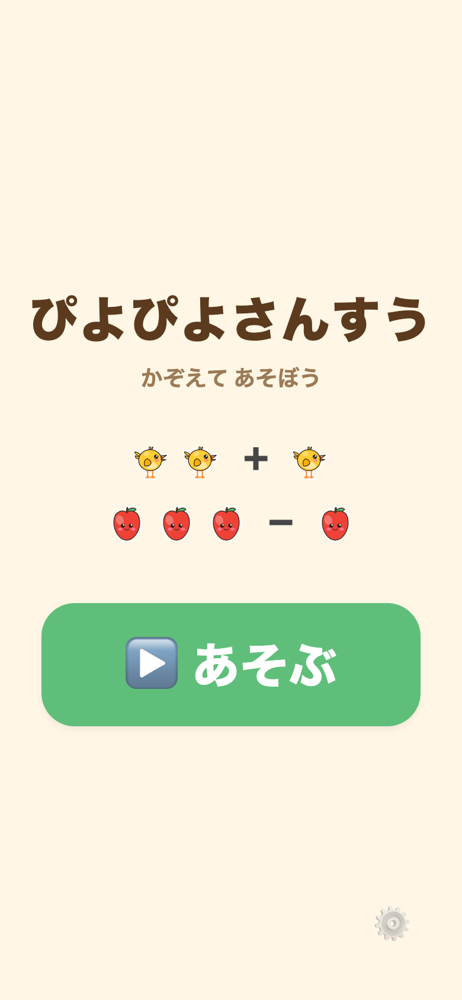

# ぴよぴよさんすう

4歳児のための、超やさしい「たしざん・ひきざん」知育アプリ。**数字の記号操作ではなく、キャラクター（モノ）が増えたり減ったりするのを見て、指でさして数える**グラフィカルなさんすう。ひよこが増える →「ぜんぶで いくつ?」、りんごが食べられる →「のこりは いくつ?」。正解すると1つずつハイライトして「1…2…3!」と数え上げて祝福する。



同じ作者の第1作 [おつかいめいろ](https://github.com/kerokero-1245/otsukai-meiro)（4歳向け・Web公開済み）と同系統。UX原則・配布方針・技術スタック・部品を流用。

## 公開URL

**▶ https://kerokero-1245.github.io/piyopiyo-sansu/**

ブラウザで開いてそのまま遊べる。スマホなら「ホーム画面に追加」で全画面起動。`main` に push すると GitHub Actions（[.github/workflows/deploy.yml](.github/workflows/deploy.yml)）が Web を書き出して自動デプロイする。

- 設計（コンセプト・画面・問題生成ロジック・4歳UX・ロードマップ）: [docs/DESIGN.md](docs/DESIGN.md)

## 状態

**フェーズ1（MVP）実装済み・Webファースト。** タイトル → もんだい（たしざん・ひきざんを混ぜて5問）→ できたね! まで遊べる。問題はシード無しのランダム生成（合計≤5・答え1〜5）。おとなモードで 10まで / 20まで（2桁のたし・ひき）に拡張できる。効果音は Web Audio 合成、増減アニメは React Native 標準 `Animated`、キャラ（モノ）はシールポップ画風の自作 SVG（`assets/svg/`）。

配布は **Webファースト**: Expo の web ビルドを URL で配布し、ブラウザで開いて「ホーム画面に追加」すれば全画面で遊べる。ネイティブアプリは同じコードから後日。詳細は [DESIGN.md §0](docs/DESIGN.md)。

### 検証（フェーズ1）

- `npx tsc --noEmit` … 型エラーなし
- `npx expo export --platform web` … 書き出し成功
- Playwright で4ビューポート（1280×800 / 1030×1368 / 515×684 / 390×844）× 全画面（タイトル / もんだい / 数え上げ / おとなモード）を目視確認。ヘッダー・問い・選択肢帯を差し引いた残り領域にモノが必ず収まる（DESIGN §8 の教訓）ことを全ビューポートで確認済み。

## 前提・方針

- 対象: 4歳（未就学・ひらがなは読み始め）。育てたいのは**数唱**と**1対1対応**。
- 数字の暗記・計算ではなく「モノを見て数える」体験に徹する。
- 罰・タイマー・スコア・ゲームオーバーなし。まちがいは「正しい数え方をもう一度見る」入口。
- 既存キャラIP（アンパンマン等）は使わない。キャラ（モノ）は自作 SVG のシールポップ素材（piyo-assets から同梱）。
- 完全オフライン: バックエンド・アカウント・通信・外部送信なし。設定は端末内のみ。
- 技術: Expo SDK 57 (React Native + TypeScript)、Node 22.23.3、アニメは標準 `Animated`。

## 動かし方

前提: **Node 22.23.3**。nvm なら `nvm use`（`.nvmrc` に 22.23.3）。

```sh
npm install          # 初回のみ
npm start            # Expo を起動 → ターミナルで w を押すと Web が開く
```

- `w` … ブラウザで開く（Webファースト。まずはこれ）
- `i` / `a` … iOS シミュレータ / Android エミュレータ（任意）

ショートカット: `npm run web`（`w` を押さず直接 Web 起動）。型の確認は `npm run typecheck`（`tsc --noEmit`）。

### Web ビルド（配布用の静的サイト書き出し）

```sh
npx expo export --platform web      # dist/ に静的ファイルを書き出す（ルート配信用）
```

GitHub Pages はサブパス（`/piyopiyo-sansu/`）配信のため、CI では `EXPO_BASE_URL=/piyopiyo-sansu` を渡して書き出す。この環境変数を [app.config.js](app.config.js) が `experiments.baseUrl` に反映し、**ビルド時のみ**アセットのベースパスを付ける（ローカルの `npm start` には影響しない）。手元で再現するなら:

```sh
EXPO_BASE_URL=/piyopiyo-sansu npx expo export --platform web
```

公開 HTML の型は [public/index.html](public/index.html)（`lang="ja"`・説明文・OGP・manifest へのリンク・読み込み中の背景色）。`public/` のほかのファイル（`manifest.webmanifest`・`icon-192.png`・`icon-512.png`・`apple-touch-icon.png`・OGP 画像 `og.png`）は書き出しにそのままコピーされる。アイコン類（`public/` と `assets/` の PNG）は、街のケーキやさんと同じ自作 SVG（piyo-assets の `cake.svg`）から作った。

### 遊び方（フェーズ1）

タイトルの「あそぶ」→ もんだい画面。モノが増える／減るのを見て「ぜんぶで／のこりは いくつ?」に3つの巨大ボタン（●●●＋数字）で答える。正解すると1つずつ数え上げ、まちがえるとボタンがぷるぷる震えて正しい数え方をゆっくり見せる（罰なし）。5問おわると「できたね!」。
※ タイトル右下（横向きのスマホでは右上）の歯車を **3秒長押し**（キーボードでは Enter / Space の長押し）すると、おとなモード（かずの範囲を 5まで／10まで／20まで で切替）に入る。
※ タイトル左上の「まちへ もどる」で ぴよぴよランド（同じオリジンの `/`）へ戻る（Web のみ。もんだい・がんばりカード・おとなモードには置かない）。

**あつめた ほし（⭐）**: 1問クリアごとに累計 `sansu.totalStars` が1つ増え、街（ぴよぴよランド）がこれを燃料として読む。おとなモードの「0に もどす」は、さんすうの中の「あつめた ほし」の表示だけを 0 から数え直す（もどした時点の累計を `sansu.starsResetAt` に控え、表示＝累計−控え。控えが累計より大きいと分かった時点で控えは捨てる＝表示は累計そのまま）。**街へ渡す累計 `sansu.totalStars` は減らさない。**

## 画面・ファイル構成

```
App.tsx                     文字ヘッダ無しの最小ステートルーター（title→play→otona）
src/
  theme.ts                  配色・フォント・余白の基準値（4歳向け）
  types.ts                  Op / CharDef / Step / StorySet / Route
  settings.ts               かずの範囲 maxSum（5/10/20）・よみあげ on/off・BGM on/off・累計⭐（街へ渡す）と表示を 0 に もどした控えの保存（web は localStorage）
  game/problems.ts          問題生成（generateStorySet のつづきもの連鎖 / makeChoices の選択肢生成）
  game/grid.ts              モノの並び（gridPlan）と、大きさの見積もり（sizingPlan・お話に出る数の最大列数）
  layout.ts                 背の低い横向き（スマホの横持ち）の判定と枠の最大幅
  audio/sounds.ts           効果音（web は Web Audio 合成、native は無音スタブ）。BGM と AudioContext を共有
  audio/voice.ts            よみあげの入口。3段構え（①同梱クリップ→②speechSynthesis→③無音）に解決。声の再生中は BGM をダッキング
  audio/clips.ts            ①同梱クリップ（VOICEVOX 事前生成）を鳴らす（tier1）
  audio/voiceClips.ts       同梱クリップの登録表（7個。require で登録）
  audio/speech.ts           ②ブラウザ内蔵 speechSynthesis（ja-JP）で読む（tier2）
  audio/bgm.ts              BGM の入口（さんすう用の薄いラッパ。開始/トグルを engine へ）
  audio/bgm/engine.ts       ぴよぴよランド共通BGMエンジン（オルゴール風・Web Audio 手続き生成ループ）
  audio/bgm/songs.ts        4曲のスコアデータ（さんすう＝F メジャーペンタ・76BPM「ほのぼの」）
  components/
    BigButton.tsx           共通の大ボタン
    ChoiceButton.tsx        選択肢の巨大ボタン（●●●＋数字）
    ThingsStage.tsx         モノの増減アニメ＋数え上げ（Animated）
    ProgressStar.tsx        進捗ドット（クリアすると⭐に変わる）
    Confetti.tsx            紙吹雪
    ClearOverlay.tsx        5問おわったときの「きょうの がんばりカード」（⭐・できたね!・あつめた ほし）
    TownLink.tsx            「まちへ もどる」（街の木の絵つき・href="/" のリンク。Web のみ）
  screens/
    TitleScreen.tsx         タイトル（あそぶ / まちへ もどる / 親ゲート）
    PlayScreen.tsx          もんだい本体（増減→数える→3択→次へ）
    OtonaScreen.tsx         おとなモード（5まで / 10まで / 20まで の切替・よみあげ する/しない・BGM ながす/ながさない・あつめた ほし の表示と 0に もどす）
public/                     Web 書き出しの HTML の型・manifest・アイコン・OGP 画像
```

## よみあげ（音声）

正解の「せいかい！」→（その後に）数え上げ、誤答の「おしい／あれれ」（ローテ・既存のぷるぷると共存）、タイトルの「ぴよぴよさんすう」、がんばりカードの「ぜんぶ できたね！」を読み上げる。おとなモードで **する／しない** を切り替えられる（既定は する）。

3段構えで解決する（[audio/voice.ts](src/audio/voice.ts)）:

1. **同梱クリップ（tier1）** … VOICEVOX 事前生成の `.m4a`。定型句7個（せいかい／タイトル／おしい／あれれ／ぜんぶできたね／きたよ／かえったよ）をすべて同梱（[assets/voice/README.md](assets/voice/README.md)）。最優先で再生。
2. **speechSynthesis（tier2）** … ブラウザ内蔵の日本語合成音声（ja-JP）。クリップを再生できない環境や、登録の無い語はここで読む。
3. **無音（tier3）** … どちらも使えない環境では黙る。**絵とアニメだけでゲームは完全に成立する**（読み上げは「あると嬉しい」補助）。

必ずユーザー操作起点で鳴らし（ブラウザの自動再生制限）、どの段でもクラッシュしない。外部送信ゼロ（同梱クリップは端末内アセット・合成は端末内）。後で VOICEVOX クリップを `assets/voice/` に足して `voiceClips.ts` に `require` を1行加えれば、同じ呼び出しのまま tier1 に上がる（呼び出し側の変更は不要）。

**クレジット: VOICEVOX:ずんだもん**（VOICEVOX 利用規約に基づく）。おとなモード画面の下部にも小さく表示。生成の再現情報は [assets/voice/README.md](assets/voice/README.md)。

## BGM（おんがく）

ぴよぴよランド4アプリ共通の**オルゴール風BGM**（[audio/bgm/](src/audio/bgm/)）。さんすうは `sansu`（F メジャーペンタ・76BPM・16小節シームレスループ「ほのぼの」）。音源ファイルは同梱せず、**Web Audio API でその場合成する手続き生成ループ**（外部送信ゼロ・完全オフライン）。効果音・声と同じ AudioContext を共有する。

- **開始**: タイトルのタップ／「あそぶ」の最初のユーザー操作（読み上げのアンロックと同じハンドラ）で `startSansuBgm()`。ブラウザの自動再生制限を守る。同一曲の再呼び出しは冪等。
- **ダッキング**: 声（せいかい／おしい・あれれ／タイトル／ぜんぶできたね＋TTS）の再生中は BGM を控えめに下げ、終わったら戻す（効果音は下げない）。「せいかい！→数え上げ」の順序は変えていない。
- **オン/オフ**: おとなモードの **ながす／ながさない**（既定は ながす）。`localStorage` キー `sansu.bgm`。OFF で即フェード停止、ON でその場で再開。
- AudioContext 非対応・`localStorage` 例外でも無害（no-op）。**絵とアニメだけでゲームは完全に成立する**。

**クレジット: BGM: オリジナル（Web Audio生成）**。録音物・外部素材は使っていない。共通基盤の詳細は piyo-assets/bgm/README.md。